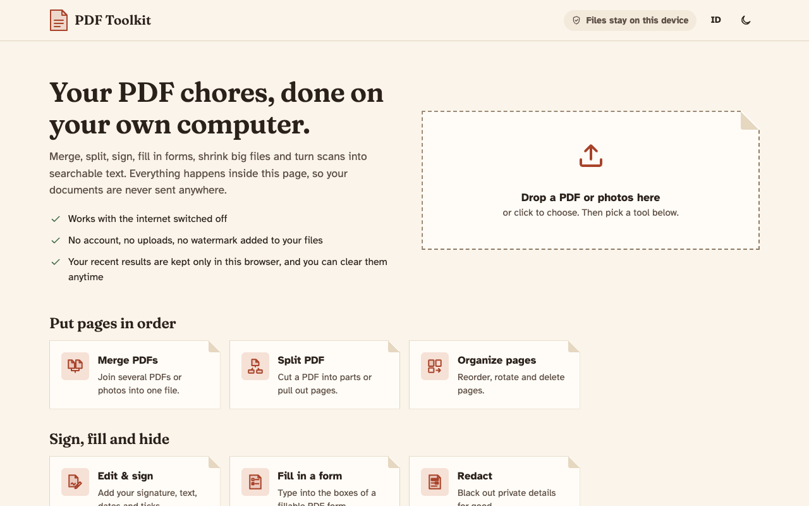
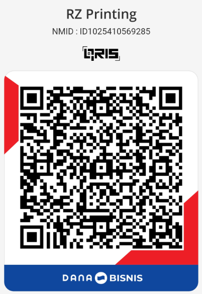

# PDF Tools

[](https://developer.mozilla.org/en-US/docs/Web/JavaScript)
[](https://webassembly.org/)
[](docs/teknis.md)
[](docs/teknis.md)
[](LICENSE)
[](https://github.com/rizalahmaddd/pdf-tools/actions/workflows/ci.yml)
[](https://pdf.solusikoding.com)

<p align="center">
  
</p>

**Stack:** Vanilla JavaScript · CSS3 · [pdf-lib](https://pdf-lib.js.org) · [PDF.js](https://mozilla.github.io/pdf.js/) · [Tesseract.js](https://tesseract.projectnaptha.com/) (WebAssembly OCR) · [JSZip](https://stuk.github.io/jszip/) · [SortableJS](https://sortablejs.github.io/Sortable/) · [esbuild](https://esbuild.github.io/)

Toolkit manipulasi dan pengelolaan PDF 100% offline dan client-side langsung di browser. Semua pemrosesan dokumen berjalan seutuhnya di perangkat lokal Anda tanpa pernah mengunggah satu byte pun file ke server eksternal, menjamin keamanan dan privasi dokumen rahasia Anda.

🌐 **Coba demo:** [pdf.solusikoding.com](https://pdf.solusikoding.com)

## Fitur

- **Gabung PDF**: Gabungkan beberapa file PDF sekaligus menjadi satu dokumen berurutan
- **Pisah PDF**: Ekstrak rentang halaman tertentu atau pisahkan dokumen per halaman
- **Atur Halaman**: Susun ulang urutan halaman (drag & drop), putar rotasi, atau hapus halaman tertentu dengan pratinjau visual
- **Tanda Tangan Digital**: Buat coretan tanda tangan langsung atau tempel gambar paraf/stempel ke posisi mana pun di atas dokumen
- **Isi Formulir (Fill Form)**: Deteksi dan isi formulir PDF interaktif (teks, centang, pilihan dropdown) secara instan
- **Sensor Dokumen (Redact)**: Tutup dan sensor area teks atau informasi sensitif secara permanen
- **Kompres PDF**: Perkecil ukuran file PDF dengan kompresi visual adaptif
- **OCR (Optical Character Recognition)**: Kenali dan ekstrak teks dari dokumen hasil scan menggunakan engine Tesseract WebAssembly lokal (Bahasa Indonesia & Inggris)
- **Ekstrak Teks**: Salin seluruh teks dari dokumen PDF ke berkas teks (.txt) murni
- **Watermark**: Tambahkan tanda air teks kustom dengan opsi transparansi, sudut rotasi, ukuran, dan warna
- **Nomor Halaman**: Berikan penomoran halaman otomatis dengan format fleksibel dan 9 pilihan posisi
- **PDF ke Gambar**: Konversi tiap halaman PDF menjadi gambar beresolusi tinggi (PNG/JPEG) yang dikemas otomatis dalam ZIP
- **Gambar ke PDF**: Satukan beberapa foto atau gambar (PNG, JPG, WebP) menjadi satu berkas PDF rapi
- **Multi-File Batch Processing**: Unggah dan proses banyak file dokumen sekaligus dalam satu alur kerja
- **100% Offline & Privasi Terjaga**: Berjalan tanpa server backend, aman untuk dokumen legal, finansial, dan identitas pribadi
- **Mode Gelap & Multibahasa**: Antarmuka responsif dengan tema gelap/terang serta dukungan Bahasa Indonesia dan Bahasa Inggris

## Cara kerja

1. Buka aplikasi di peramban atau jalankan file HTML secara offline.
2. Pilih modul alat PDF yang ingin digunakan di bilah navigasi.
3. Unggah atau tarik & letakkan (drag and drop) file dokumen Anda.
4. Sesuaikan konfigurasi sesuai kebutuhan, lalu unduh hasilnya seketika.

## Mulai cepat

```bash
npm install                   # pasang dependensi
node build.mjs                # build bundel aplikasi ke folder dist/
open "dist/PDF Toolkit.html"  # jalankan langsung di browser
```

## Dokumentasi

- [Dokumentasi Teknis](docs/teknis.md): arsitektur client-side, modul engine, build pipeline, dan pengujian

## Dukung & Donasi

Jika proyek ini bermanfaat bagi Anda, dukung pengembangannya melalui **QRIS**:

<p align="center">
  
  <br>
  <em>Scan QRIS menggunakan BCA, Mandiri, BRI, GoPay, OVO, DANA, ShopeePay, atau mobile banking lainnya.</em>
</p>

## Kontak

Dikembangkan oleh **rizalahmaddd**:
- **WhatsApp**: [+62 857-7777-5477](https://wa.me/6285777775477)
- **GitHub**: [@rizalahmaddd](https://github.com/rizalahmaddd)
- **Lokasi**: Kota Malang, Jawa Timur, Indonesia

## Lisensi

Proyek ini dilisensikan di bawah lisensi [MIT License](LICENSE).  
Rincian lisensi dependensi pihak ketiga (*third-party libraries*) dapat dilihat di [assets/THIRD-PARTY-LICENSES.txt](assets/THIRD-PARTY-LICENSES.txt).
